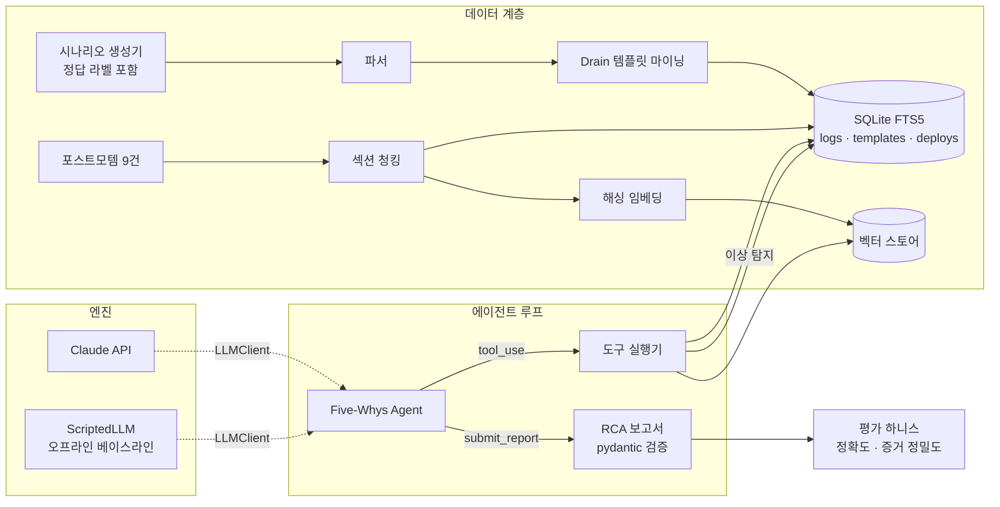

# Five Whys Agent

**LLM 에이전트 기반 장애 로그 근본원인분석(RCA) 자동화**

장애가 나면 SRE는 로그를 뒤지고, 배포 이력을 대조하고, "왜?"를 반복하며 근본 원인을
추적합니다. 이 프로젝트는 그 과정 — 도요타의 **5 Whys 기법** — 을 LLM 에이전트의
루프 설계로 옮긴 시스템입니다. 에이전트는 매 단계 도구를 호출해 **로그 증거를 수집**하고,
증거 없는 결론을 내릴 수 없도록 강제됩니다.

```
장애 발생 → [에러 타임라인] → [이상 템플릿 탐지] → [로그 검색/문맥] → [변경 이력 대조]
         → [과거 유사 장애 RAG] → 5 Whys 보고서 (모든 단계에 로그 id 인용)
```

## 왜 이 프로젝트인가

문서 요약 챗봇류 프로젝트와 달리, 이 프로젝트는 **"LLM의 결론을 어떻게 신뢰할 것인가"**
라는 문제를 정면으로 다룹니다.

1. **증거 강제**: 보고서의 모든 "왜?" 단계는 실제 로그 id를 인용해야 하며,
   평가 하니스가 인용된 id의 실존/시간창 포함 여부를 검증합니다 (환각 인용 탐지).
2. **정량 평가**: 정답을 아는 합성 장애 시나리오 5종(시드 가변)으로
   근본원인 서비스 정확도, 원인 변경 식별율, 증거 정밀도를 자동 채점합니다.
3. **베이스라인 비교**: LLM 없이 동작하는 휴리스틱 엔진(ScriptedLLM)이 같은
   에이전트 루프를 돌기 때문에, "LLM이 휴리스틱 대비 무엇을 더 잘하는가"를
   같은 잣대로 비교할 수 있습니다.

## 핵심 구성 요소

| 구성 요소 | 구현 내용 |
|---|---|
| 로그 템플릿 마이닝 | **Drain 알고리즘 직접 구현** (파라미터 마스킹 + 고정 깊이 prefix tree + 토큰 유사도 병합) |
| 이상 탐지 | 베이스라인 대비 장애 구간 템플릿 발생률 비교 (레벨 가중 log-ratio 스코어) |
| 로그 검색 | SQLite **FTS5 BM25** (운영 규모용 **Elasticsearch 어댑터** 포함, 동일 인터페이스) |
| RAG | 과거 장애보고서 9건 → 섹션 인지 청킹 → 임베딩 → **하이브리드 검색(BM25+벡터+RRF)** |
| 에이전트 | Claude Messages API **수동 tool-use 루프** (7개 도구, 보고서 스키마 pydantic 검증 + 자가 수정) |
| MCP 서버 | 로그 분석 도구를 **MCP 표준**으로 노출 → Claude Desktop/Code에서 바로 사용 |
| 평가 | 규칙 기반 자동 채점 + 선택적 LLM-as-judge (구조화 출력) |
| API/CLI | FastAPI REST API + CLI (`demo` / `evaluate` / `serve` / `mcp-serve`) |

## 아키텍처



## 빠른 시작

```bash
git clone <repo-url> && cd five-whys-agent
python -m venv .venv && source .venv/bin/activate
pip install -e ".[dev,mcp]"

# 1) API 키 없이 바로 실행되는 오프라인 데모 (휴리스틱 베이스라인)
fivewhys demo --scenario db_pool_exhaustion

# 2) Claude 에이전트로 실행
export ANTHROPIC_API_KEY=sk-ant-...
fivewhys demo --scenario cache_stampede --engine claude

# 3) 전 시나리오 정량 평가
fivewhys evaluate --engine scripted --runs 3

# 4) REST API
fivewhys serve   # POST /analyze, GET /scenarios, GET /reports/{id}

# 5) MCP 서버 (Claude Desktop/Code 연동)
fivewhys mcp-serve --scenario db_pool_exhaustion

# 테스트
pytest
```

## 데모 출력 (오프라인, API 키 불필요)

```
[5 Whys 인과 사슬]
  Why 1. 왜 사용자 요청에 문제가 생겼는가?
     → api-gateway에서 'Upstream timeout: order-service GET <*> ...' 패턴이
       급증했다 (장애 구간 48건, 베이스라인 0건).   증거 로그: [1913, 1916, 1925]
  Why 2. 왜 api-gateway의 처리에 문제가 생겼는가?
     → order-service에서 'HikariPool-1 - Connection is not available ...' 패턴이
       급증했다 (장애 구간 58건, 베이스라인 0건).   증거 로그: [1819, 1821, 1823]
  Why 3. 왜 order-service에서 이 문제가 시작됐는가?
     → 장애 직전 변경: order-service v2.4.0 배포 — 주문 조회 쿼리 리팩터링

[근본 원인] (order-service) ... 트리거는 'v2.4.0 배포'로 판단
[유사 과거 장애] 2025-11-14-db-connection-pool
```

## 평가 결과

시나리오 5종 × 시드 3개 = 15회 실행 (`fivewhys evaluate --runs 3`):

| 엔진 | 근본원인 서비스 정확도 | 키워드 정확도 | 원인 변경 식별 | 평균 증거 정밀도 |
|---|---|---|---|---|
| scripted (베이스라인) | 100% (15/15) | 100% | 100% | 1.00 |

> 합성 시나리오는 베이스라인 휴리스틱이 만점을 받도록 설계된 난이도입니다.
> 이 표의 의미는 "채점 파이프라인이 신뢰 가능하게 동작한다"는 것이고,
> LLM 엔진의 가치는 휴리스틱이 못 푸는 케이스(간헐 장애, 다중 원인,
> 로그에 직접 드러나지 않는 원인)에서 나타납니다 — [docs/EVALUATION.md](docs/EVALUATION.md) 참고.

측정 항목:
- **근본원인 서비스 정확도** — 인과 사슬의 출발 서비스를 맞췄는가 (에러가 가장 많은 서비스 ≠ 근본 원인)
- **원인 변경 식별** — 장애를 유발한 배포/설정 변경을 특정했는가
- **증거 정밀도** — 인용한 로그 id가 실존하며 장애 구간에 속하는 비율 (환각 인용 탐지)

## 기술적 의사결정

| 결정 | 이유 |
|---|---|
| Drain을 라이브러리 대신 직접 구현 | 대용량 로그 → 템플릿 압축이 이 도메인의 핵심이라 내부 동작을 이해하고 통제해야 했음. 테스트에 알고리즘의 알려진 한계(선행 토큰 파라미터 분화)도 명시 |
| SQLite FTS5 기본 + ES 어댑터 | 로컬에서 외부 의존성 0으로 전체 파이프라인 실행 가능. 검색 인터페이스를 추상화해 운영 환경에서는 Elasticsearch로 교체 (`store/es.py` + docker-compose) |
| RRF 하이브리드 검색 | BM25(정확 용어)와 벡터(의미 유사) 랭킹을 점수 보정 없이 순위로 융합 — Elasticsearch hybrid search와 동일 방식 |
| 수동 tool-use 루프 | SDK 헬퍼 대신 루프를 직접 구현해 (1) LLMClient 추상화로 오프라인 엔진 교체 가능 (2) 보고서 제출을 가로채 pydantic 검증 → 실패 시 오류를 돌려줘 모델이 자가 수정 |
| ScriptedLLM 베이스라인 | "에이전트 루프"와 "LLM 품질"을 분리해 테스트. CI에서 API 비용 0으로 전체 통합 테스트, 평가에서는 LLM 대비 기준선 역할 |
| 임베딩 추상화 (기본: 해싱 벡터라이저) | 외부 모델 의존 없이 결정적으로 동작 → 재현 가능한 테스트. `Embedder` 프로토콜만 만족하면 sentence-transformers 등으로 교체 가능 |
| 합성 시나리오 + 정답 라벨 | LLM 출력의 "그럴듯함"이 아니라 검증 가능한 정확도로 평가. 실로그는 정답이 없어 정량 평가 불가 |

## 프로젝트 구조

```
src/fivewhys/
├── logs/          # parser, drain(템플릿 마이닝), anomaly(이상 탐지)
├── store/         # SQLite FTS5 저장소, Elasticsearch 어댑터
├── rag/           # chunker, embedder, vectorstore, retriever(RRF)
├── scenarios/     # 정답 라벨 포함 합성 장애 시나리오 5종
├── agent/         # LLM 추상화, 도구 정의/실행기, Five-Whys 루프, 오프라인 엔진
├── evaluation/    # 규칙 기반 채점 하니스, LLM-as-judge
├── mcp_server/    # MCP 표준 서버 (Claude Desktop/Code 연동)
├── data/postmortems/  # 과거 장애 보고서 코퍼스 9건 (RAG 지식베이스)
├── api.py         # FastAPI REST API
└── cli.py         # CLI 진입점
tests/             # 68개 테스트 (전부 오프라인, API 키 불필요)
```

## 한계와 로드맵

- **합성 데이터의 한계**: 시나리오가 "변경 → 장애" 패턴에 치우쳐 있어 베이스라인도
  만점이 나온다. 실제 가치 검증을 위해 휴리스틱이 실패하는 시나리오
  (다중 복합 원인, 로그에 없는 원인, 오해를 유발하는 무관 배포)를 추가할 계획
- **스트리밍 적재**: 현재는 배치 적재. Drain은 온라인 알고리즘이므로 Kafka 등
  스트림 소스 연결이 자연스러운 다음 단계
- **임베딩 업그레이드**: 해싱 벡터라이저 → 다국어 임베딩 모델 교체 후 검색 품질 A/B
- **LLM-judge 상시화**: 현재는 선택 실행. 체인 일관성 채점을 평가 기본 항목으로 편입

## 라이선스

MIT
