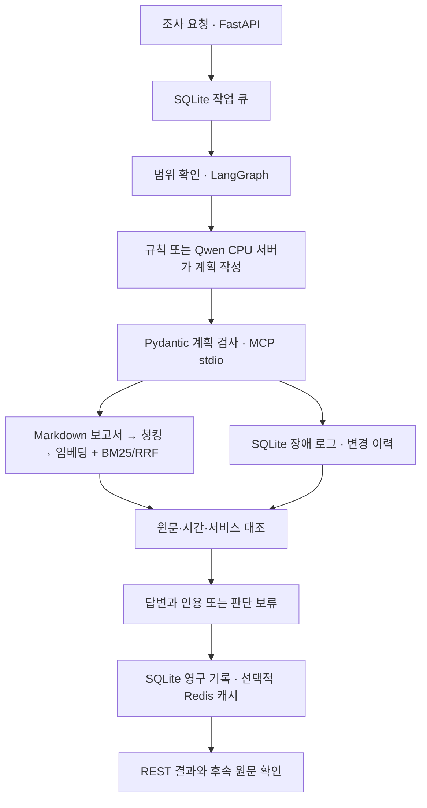

# 주문 서비스 장애 조사 데스크

**면접 시연**　[공개 데모](https://sokldjs554.github.io/five-whys-agent/desk/) · [공고 원문 대조표](requirements.md) · [저장소 선정 근거](selection.md) · [평가와 실패 사례](evaluation/README.md) · [화면 설계·캡처](design.md) · [배포 버전·CI](release.md)

합성 주문 서비스의 지연 신고를 받은 운영자가 배포 직전의 변경, 장애 창의 실제 로그, 이전 장애보고서를 대조하는 Python 프로젝트다. 로그인 없이 데모의 **조사 기록 선택**을 열고, 결과 문장의 근거 번호를 누른 뒤 **도구 호출 기록**을 펼치면 해당 실행의 입력과 반환값을 확인할 수 있다. 보류 사례에는 사유와 실행된 단계가 남는다. 공개 화면은 저장된 실행을 보여 주며 새 모델 호출은 로컬 실행 경로에서 시작한다.

## 코드와 데이터 흐름



| 확인할 동작 | 코드 또는 근거 |
|---|---|
| 작업 접수, 대기·실행·종료, 중단 이유, 재시작 후 조회 | [HTTP 경로](../../src/fivewhys/desk/routes.py) · [SQLite 작업 저장소](../../src/fivewhys/desk/jobs.py) |
| 실제 모델이 첫 도구 및 검색어 결정, 도구·인자 검증과 제한된 그래프 실행 | [로컬 모델](../../src/fivewhys/desk/local_model.py) · [그래프](../../src/fivewhys/desk/engine.py) · [MCP 클라이언트](../../src/fivewhys/desk/mcp_tools.py) |
| 근거 부족·충돌 보류, 현재 배포와 과거 사례 구분 | [판정·인용](../../src/fivewhys/desk/evidence.py) · [테스트](../../tests/test_desk_engine.py) |
| 문서 적재, 임베딩 및 순위 결합 | [파이프라인](../../src/fivewhys/pipeline.py) · [검색기](../../src/fivewhys/rag/retriever.py) · [학습 모델 임베딩 서빙·배치 실험](embeddings.md) |
| 공개 화면·실행 원본·측정 기준 | [UI 소스](../../desk-demo/) · [원자료](evaluation/) · [평가 코드](../../scripts/desk_eval.py) |
| Redis와 Kubernetes 실험 | [배포 설정](../../deploy/desk/) · [실행 기록](ops.md) |

세 가지 독립적인 자료가 있어야 변경을 원인 후보로 제시한다. 읽기 전용 도구 세 종류는 업무 정책으로 정하며, 모델은 순서와 검색어를 결정한다. 최종 답변은 검증한 구절을 Python이 조립한다. 추론을 실행하지 않은 규칙 경로와 이전 별도 브랜치의 실제 Claude 네이티브 Tool Use도 각각 표시한다. [로컬 모델·라이선스·실행법](local-model.md) · [이전 Claude 기록](https://sokldjs554.github.io/five-whys-agent/claude.html)

## 실행

Python 3.12에서 확인했다. 저장소를 체크아웃한 디렉터리 안에서 실행한다.

```sh
python -m venv .venv
. .venv/bin/activate
python -m pip install -e '.[dev,desk-cache]'
python -m pytest -o addopts='' -q
python -m uvicorn fivewhys.api:app --host 127.0.0.1 --port 8000
```

`http://127.0.0.1:8000/desk/`에서 새 질문을 입력한다. **규칙 기반**은 모델 없이 전체 MCP 조사 경로를 실행한다. **로컬 모델**은 다른 터미널에서 `bash scripts/serve_desk_model.sh`로 서버가 준비된 뒤 선택한다. 서버는 Linux x86-64용이다. Python API와 Swagger UI는 각각 `/desk/jobs`, `/docs`에서 제공한다. 소스 체크아웃의 웹 자산은 자동으로 탐색한다. 별도 패키지 배포에서는 `DESK_ASSETS`로 정적 파일 디렉터리를 지정한다.

```sh
# 접수 → 상태 확인 → 결과 → 인용 원문 후속 조회를 HTTP로 실행
python scripts/check_desk_api.py --engine rules
python scripts/check_desk_api.py --engine local --question '주문 서비스의 DB 연결 풀 오류와 관련된 배포를 조사해 줘'
# 평가 원본을 보존하면서 새 측정
python scripts/desk_eval.py --mode offline --split development --repeats 3 --results-dir /tmp/desk-eval
```

| 요청 | 결과 |
|---|---|
| `POST /desk/jobs` + `{"question":"주문 서비스 로그와 관련 배포를 조사해 줘","engine":"rules"}` | 202, 작업 ID와 조회 URL |
| `GET /desk/jobs/{id}` | 상태 및 접수·시작·완료 시각, 실패 유형 |
| `GET /desk/jobs/{id}/result` | 진행 중 409, 종료 후 답변·보류 사유·도구 실행·인용 |
| `POST /desk/jobs/{id}/messages` + `{"citation_id":"change:2"}` | 해당 조사에서 확인한 인용에 대한 후속 원문 답변을 기록 |
| `GET /desk/jobs/{id}/messages` | 같은 작업의 원문 확인 대화 이력 |

작업 상태와 인용 후속 조회는 기본 `.fivewhys/jobs.db`에 보존한다. 취소·종료 시 상태와 이유를 남기고, 응답 도중 워커가 사라진 경우 만료된 작업을 실패로 처리한다. 검증 서비스는 단일 호스트 또는 단일 Pod의 합성 데이터용이다. 사용자 인증·팀별 접근 제어가 필요한 운영 시스템은 별도 검증이 필요하다.

## 수행자와 재현 범위

- **지원자가 직접 한 것으로 기록된 작업**은 [선정 근거](selection.md)와 [공고 대조표](requirements.md)에 원본 제출물과 함께 표시했다. 이전 저장소의 작성자 계정만으로 개인 기여를 단정하지 않았다.
- **Codex가 이번에 한 작업**은 저장소·공고 조사, 조사 데스크·모델·검색·HTTP·화면 구현, 테스트 및 오류 주입, 클러스터 실험, 평가·캡처·공개 배포다. 재사용한 기존 구현과 외부 의존성의 출처는 [재사용·라이선스 정리](selection.md)에 있다.
- **지원자 본인의 이번 버전 검토·재현**은 확인 기록이 없다. 위 명령으로 새 실행의 질문, 모델, 실행 ID와 원자료를 직접 대조할 수 있다.
